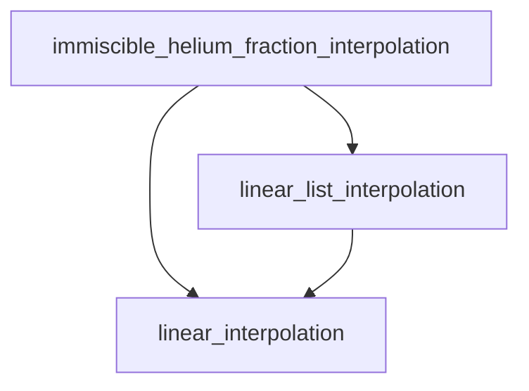

# element_sedimentation
An implementation of element sedimentation in MESA.

## Quickstart
### Installation
Go inside the `element_sedimentation` directory and run `python setup.py install` to install the helium rain package. This will copy the Fortran source files into your MESA project and compile them. Afterwards, run `./mk` inside the test suite `planet_helium_rain` to check if everything is working correctly. For your own project, don't forget to run `./clean` and `./mk` to ensure that the new files are compiled correctly.
### Options
The current options for helium rain are (reproduced from the `&controls` reference file of your MESA project):

```fortran
! Element Sedimentation
! ===================

      ! do_element_sedimentation
      ! ~~~~~~~~~~~~~~

      ! Turn on sedimentation of elements in the model; primarily used for helium rain.

      ! ::

    do_element_sedimentation = .false.

      ! element_sedimentation_method
      ! ~~~~~~~~~~~~~~
      
      ! Method to use for the mass transfer of the helium rain.
      ! Options are 'instant_rain', 'bottom_up_rain', and 'advection_diffusion_rain' (in increasing order of complexity).
      ! 'instant_rain' will transfer all the rain mass at once, updating the model afterwards.
      ! 'bottom_up_rain' will transfer the rain cell by cell from the bottom up, adjusting the model as it goes.
      ! 'advection_diffusion_rain' runs a full advection-diffusion solver until a steady state between advecting rain and diffusing convection is reached.
      
      ! ::
    
    element_sedimentation_method = 'instant_rain'
    
      ! element_sedimentation_velocity_method
      ! ~~~~~~~~~~~~~~
      
      ! The method to use for determining the sedimentation velocity of the element. Only applies to 'advection_diffusion_rain'.
      ! Currently, only 'constant' is supported.
      
      ! ::
    
    element_sedimentation_velocity_method = 'constant'
    
      ! element_sedimentation_velocity
      ! ~~~~~~~~~~~~~~
      
      ! Sedimentation velocity of the element droplets in cm/s. Only applies to 'advection_diffusion_rain'.
      
      ! ::
    
    element_sedimentation_velocity = 1d2
    
      ! element_sedimentation_advection_diffusion_time_step_factor
      ! ~~~~~~~~~~~~~~

      ! The time step for the advection-diffusion solver is determined as a fraction of the advection/diffusion time scale.
      ! element_sedimentation_advection_diffusion_time_step_factor is the factor that is multiplied with the advection/diffusion time scale to determine the time step.
      ! Only applies to 'advection_diffusion_rain'.

      ! ::
  
    element_sedimentation_advection_diffusion_time_step_factor = 0.5d0

      ! element_sedimentation_maximum_dXi_per_cell
      ! ~~~~~~~~~~~~~~

      ! Maximum allowed absolute change in the abundance of the sedimenting species per cell during an evolution step.
      ! Can help with convergence if too much material is raining out at once.
      ! Negative values will disable this limit.

      ! ::

    element_sedimentation_maximum_dXi_per_cell = -1d0

      ! element_sedimentation_phase_diagram
      ! ~~~~~~~~~~~~~~
      
      ! Path to the phase diagram file for the sedimenting chemical species. The file should be a CSV file with the following columns:
      ! One header line with the column names (lower miscibility limit, upper miscibility limit, temperature (K), pressure (Mbar)).
      ! Followed by the data lines (comma separeted) with the values for each column.

      ! ::

    element_sedimentation_phase_diagram = 'src/phase_diagrams/Schöttler+2018.csv'

      ! element_sedimentation_phase_diagram_temperature_shift
      ! ~~~~~~~~~~~~~~

      ! Temperature shift to apply to the phase diagram in Kelvin.
      ! This can be used to account for uncertainties in the phase diagram.

      ! ::

    element_sedimentation_phase_diagram_temperature_shift = 0d0


      ! element_sedimentation_extrapolate_phase_diagram
      ! ~~~~~~~~~~~~~~

      ! If true, the phase diagram will be (linearly) extrapolated in temperature outside of the range of the phase diagram.
    
      ! ::

    element_sedimentation_extrapolate_phase_diagram = .false.

    
      ! element_sedimentation_chemical_species
      ! ~~~~~~~~~~~~~~

      ! Chemical species to use for the sedimentation. This should be the name of the element in the phase diagram file.
      ! The default is 'he4' for helium rain, but can be changed to other elements if needed.

      ! ::

    element_sedimentation_chemical_species = 'he4'
```

## Details

This repository contains two folders: `helium_rain` and `planet_helium_rain`. The `helium_rain` folder contains the code for the helium rain algorithm, while the `planet_helium_rain` folder is a test suite for the helium rain algorithm.

## Files
- `element_sedimentation.f90`: The main Fortran module implementing element sedimentation.
- `controls.defaults`: Default controls/documentation for the element sedimentation module.
- `ctrls_io.f90`: File containing the assignment of the new star_info variables.
- `evolve.f90`: The main evolution loop that calls the element sedimentation module.
- `star_data_step_work.inc`: Other star_type variables that are used by the element sedimentation module but are not a user input.
- `alloc.f90`: Allocates `s% eps_element_sedimentation`.
- `init.f90`: Calls `shutdown_phase_diagram` and `init_element_sedimentation`.
- `makefile_base`: Add `element_sedimentation.f90` to the list of source files to compile.
- `star_controls.inc`: Contains the type definitions for the new controls used by the element sedimentation module.

## new variables besides options
- `s% eps_element_sedimentation` for energy accounting of the element sedimentation process.
- `s% total_energy_from_element_sedimentation` for accounting of the total energy released by the element sedimentation process.

## Function overview
The code computes an array $dY$, that is the change in the helium mass fraction due to sedimentation. Once obtained, the mass abundances are changed according to
$$dX_i = \frac{- dY}{1-Y} X_i$$
where $X_i$ is the mass fraction of the $i$-th chemical species and $Y$ is the helium mass fraction.
### immiscible_helium_fraction_interpolation

`immiscible_helium_fraction_interpolation` is a core routine for determining the boundaries of helium immiscibility as a function of pressure and temperature. It interpolates values from a given phase diagram table and returns the minimum and maximum helium mass fractions for which the material is immiscible.

#### Purpose

This function takes a given pressure (`P0`) and temperature (`T0`) and, by interpolating within the phase diagram, determines the corresponding values for `Y_min` and `Y_max`. These values define the range of helium mass fraction where the material is immiscible. If the current helium content is outside this range, the material is fully miscible.

#### How it works

- **Inputs:**  
  - Pressure `P0` (in cgs units)
  - Temperature `T0` (in cgs units)
  - Phase diagram data structure `pd`
- **Outputs:**  
  - `Y_min`, `Y_max`: immiscibility boundaries
  - `ierr`: error code

The routine first finds the appropriate pressure and temperature intervals in the phase diagram and then uses linear interpolation to determine `Y_min` and `Y_max`. The helper functions `linear_list_interpolation` and `linear_interpolation` are called during this process.

#### Flow chart



#### Example usage

```fortran
call immiscible_helium_fraction_interpolation(P0, T0, pd, Y_min, Y_max, ierr)
```

#### Notes

- The function assumes that the phase diagram is loaded and consistent.
- Errors are indicated via the `ierr` return value.